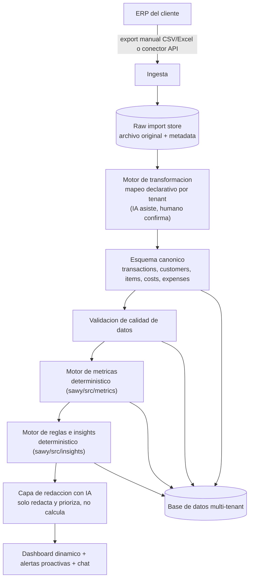

# RFC: Sawy como plataforma multi-cliente de visibilidad de negocio

- Estado: borrador, para discusión
- Autor: Nicolás Clos
- Fecha: 2026-09-29
- Contexto: generalización de la herramienta construida para Tostadero Ruta 9
  (`sawy/`, este mismo repo) en una plataforma que se pueda vender a múltiples
  clientes de distintos rubros, con distintos sistemas de gestión.

## 1. Resumen

Hoy `sawy/` resuelve el problema de **un** cliente: alguien (yo) lee los
CSV de Tostadero Ruta 9, escribe a mano el mapeo de columnas, las reglas de
limpieza y los umbrales de alerta en código, y genera un HTML estático.
Funciona, pero no escala: cada cliente nuevo implica repetir ese trabajo de
ingeniería a mano (ver `respuestas.txt`, pregunta 2, sobre qué de esto es
reusable y qué no).

Esta RFC propone separar ese trabajo en dos categorías:

1. **Lo que hoy es código y debería ser motor + configuración** (mapeo de
   columnas, reglas de negocio, umbrales de alerta): se generaliza en un
   motor que cualquier cliente nuevo pueda usar declarando su propio mapeo,
   no reescribiendo `ingest/` y `clean/`.
2. **Lo que hoy es un archivo generado una vez y debería ser una
   aplicación viva**: reemplazar "correr un script y mandar un HTML" por una
   plataforma multi-tenant con datos persistidos, actualizables, y un
   dashboard dinámico (con alertas proactivas y un chat sobre los datos,
   como hace Sawy.io real).

La IA entra en puntos específicos y acotados de este pipeline — nunca para
calcular cifras financieras, siempre para tareas de lenguaje o de asistencia
(ver sección 4.4). Esta distinción es, a mi criterio, la decisión de diseño
más importante de todo el documento.

## 2. Motivación

Construir la versión para Tostadero Ruta 9 dejó tres aprendizajes concretos
que motivan esta RFC:

- **El 80% del esfuerzo no fue calcular métricas, fue entender datos
  sucios.** Encontrar que `BLEND1K` era un código legado de `CAF-BLEND-1K`,
  que las notas de crédito vienen con signo negativo, que una columna trae
  un `;` dentro de comillas: nada de eso lo dice un enunciado, se descubre
  mirando el dato real. Un producto que le vendamos a un cliente nuevo va a
  tener su propia versión de estos problemas, y no podemos facturar cada
  vez el equivalente a "un ingeniero se sienta una semana a auditar tus
  CSV a mano".
- **Las reglas de alerta son juicio de negocio, no lógica universal.** Que
  25% de concentración en un cliente sea grave, o que 3% de devolución sea
  demasiado, son umbrales que definí mirando el negocio de Sofía. Para que
  esto escale, esos umbrales tienen que poder ajustarse sin tocar código.
- **El entregable de hoy (un HTML que se regenera a mano) no es un
  producto, es un informe.** Un producto real necesita datos persistidos,
  actualizaciones cuando llega información nueva, y alguien (o algo) que
  avise proactivamente en vez de esperar que el cliente abra un archivo.

## 3. Objetivos y no objetivos

**Objetivos:**

- Onboardear un cliente nuevo sin escribir código por cliente: configurar
  un mapeo, no programar un `ingest/` nuevo.
- Mantener la garantía que ya tiene `sawy/` hoy: los números que ve el
  cliente son 100% trazables a una cuenta determinística, nunca "porque lo
  dijo un modelo".
- Usar IA donde de verdad aporta (asistir el mapeo inicial, redactar/
  priorizar en lenguaje natural, responder preguntas libres) sin que la IA
  se vuelva la fuente de verdad de ningún número.
- Que el negocio (nosotros) pueda vender esto como suscripción: un cliente
  nuevo se onboardea en días, no en semanas de desarrollo a medida.

**No objetivos (por ahora):**

- No vamos a soportar "cualquier ERP del mundo" desde el día uno. Se prioriza
  un puñado de sistemas de gestión comunes en pymes de Argentina/LatAm
  (Tango Gestión, Bejerman, Xubio, Contabilium, Colppy) más un conector
  genérico de CSV/Excel para todo lo demás.
- No reemplaza a un contador ni da asesoramiento financiero regulado: da
  visibilidad operativa y sugerencias, la decisión la sigue tomando el
  dueño del negocio.
- La IA no ejecuta acciones sobre el negocio del cliente (no cambia precios,
  no manda mails a clientes de Sofía en su nombre). Siempre hay una persona
  en el medio para actuar.

## 4. Arquitectura propuesta



Los rectángulos G y H son, literalmente, generalizaciones de
`sawy/src/metrics/index.js` y `sawy/src/insights/index.js` tal como existen
hoy: la lógica de "agrupar y sumar" y de "reglas que devuelven severidad +
acción" ya está escrita y probada. Lo que cambia es que dejan de operar
sobre un array en memoria de un solo cliente y pasan a operar sobre datos
persistidos de N tenants.

### 4.1 Ingesta

Dos vías, conviviendo:

- **Upload manual** (lo que tenemos hoy): el cliente sube un CSV/Excel
  desde una pantalla. Sirve para arrancar rápido con cualquier cliente,
  sin importar su ERP.
- **Conectores directos** (a construir por prioridad de demanda): el
  sistema se conecta a la API/base del ERP y trae los datos solo, sin que
  el cliente tenga que acordarse de exportar nada. Esto elimina de raíz la
  causa de varios de los problemas de datos que encontramos (el código de
  producto legado probablemente entró en algún momento de una migración o
  carga manual).

Cada import (manual o por conector) se guarda tal cual llegó, sin
transformar, en un `raw_import` con su archivo original y metadata (quién,
cuándo, de qué fuente). Esto es la base para poder auditar y para poder
reprocesar si mañana cambia una regla de transformación.

### 4.2 Estandarización: esquema canónico + motor de transformación

Esta es la generalización de `sawy/src/ingest/` y `sawy/src/clean/`. Hoy
esas dos capas son código escrito a mano para las columnas exactas de
Tostadero Ruta 9. En la plataforma, se convierten en:

- Un **esquema canónico** fijo (independiente del ERP de origen), descrito
  en la sección 5.
- Un **mapeo declarativo por tenant** (no código): qué columna de origen
  corresponde a qué campo canónico, con su tipo y formato. Ejemplo,
  expresado como configuración en vez de como el `ingest/index.js` actual:

  ```json
  {
    "source_columns": {
      "fecha": { "canonical_field": "transaction.date", "type": "date", "format": "DD/MM/YYYY" },
      "codigo_producto": { "canonical_field": "transaction.item_code", "type": "string" },
      "importe": { "canonical_field": "transaction.net_amount", "type": "decimal" }
    },
    "value_mappings": [
      { "field": "transaction.item_code", "from": "BLEND1K", "to": "CAF-BLEND-1K" }
    ],
    "business_rules": {
      "channel_source": "customer.commercial_condition",
      "cost_join_key": ["item_code", "period"]
    }
  }
  ```

  El mapeo de `BLEND1K → CAF-BLEND-1K` que hoy vive hardcodeado en
  `sawy/src/clean/index.js` es exactamente el tipo de regla que en la
  plataforma tiene que poder cargar un analista de onboarding sin tocar
  código ni redeployar nada.

- Un **motor de validación de calidad de datos**, que generaliza los
  `warnings` que ya devuelve `enriquecerVentas()`: en vez de imprimirse por
  consola, se guardan como `data_quality_issue` y se muestran en una
  pantalla de onboarding para que un humano decida si son aceptables antes
  de activar el dashboard del cliente.

### 4.3 Cálculo de métricas y reglas (determinístico)

Sin cambios de fondo respecto a lo que ya existe en `sawy/src/metrics/` e
`sawy/src/insights/`: agregaciones puras sobre el esquema canónico, y reglas
independientes que devuelven severidad + acción. La diferencia es que:

- Los umbrales (25% de concentración, 3% de devolución, etc.) dejan de ser
  constantes en el código y pasan a ser configuración por tenant, con
  valores por defecto razonables sugeridos según el tamaño/rubro del
  negocio (acá es donde tendría sentido que la IA proponga un punto de
  partida, no que lo defina un ingeniero mirando un solo cliente como hice
  yo con Sofía).
- El resultado de correr este motor se guarda como `metric_snapshot` (no se
  recalcula en cada request): se recalcula cuando entran datos nuevos, no
  cuando alguien mira el dashboard.

### 4.4 Dónde entra la IA (y dónde no)

Este es el punto que más vale la pena dejar explícito, porque es donde un
diseño ingenuo se puede ir de las manos: **la IA nunca calcula un número
que después se le muestra al cliente como un hecho financiero.** Todo
número sale del motor determinístico de 4.3. La IA participa en cuatro
lugares, todos "aguas abajo" de un cálculo ya hecho o "aguas arriba" de una
decisión que igual confirma una persona:

1. **Asistir el mapeo inicial (onboarding).** Dado un CSV nuevo con
   columnas como `imp_total` o `cod_art`, un LLM puede sugerir a qué campo
   canónico corresponde cada una. Un humano (nuestro, o eventualmente el
   propio cliente) confirma o corrige antes de que el mapeo quede activo.
   Nunca se aplica un mapeo sugerido por IA sin confirmación.
2. **Sugerir umbrales de alerta iniciales**, en base a rubro/tamaño del
   negocio, como punto de partida editable — no como valor final.
3. **Redactar y priorizar en lenguaje natural** los insights que ya generó
   el motor determinístico: tomar `{severity: "critical", ingresos: 22421268,
   resultadoNeto: -265094, ...}` y convertirlo en una explicación fluida, o
   priorizar cuál de 6 alertas mostrar primero según lo que el cliente
   preguntó la semana pasada. La IA recibe números ya calculados, nunca los
   inventa.
4. **Chat conversacional sobre los datos** ("¿cómo vienen las devoluciones
   este mes?"): un LLM con function-calling sobre un set acotado de
   consultas predefinidas y seguras contra el `metric_snapshot` del tenant
   (nunca SQL libre generado por el modelo y ejecutado directo contra la
   base de producción). Si la pregunta no matchea ninguna consulta
   disponible, el chat lo dice en vez de inventar una respuesta.

### 4.5 Entrega: dashboard dinámico, no archivo estático

El HTML autocontenido de hoy fue la decisión correcta para un entregable de
un solo cliente sin backend (ver `sawy/README.md`). Para una plataforma con
múltiples clientes y datos que cambian, deja de tener sentido: se reemplaza
por una aplicación real (backend con API + frontend), pero se **reutiliza
el sistema de diseño** ya construido (paleta, tarjetas de KPI, tarjetas de
alerta con severidad, gráficos) como punto de partida de los componentes de
UI, en vez de arrancar de cero.

## 5. Esquema canónico (propuesta inicial)

Generalización directa de los 5 CSV de Tostadero Ruta 9 a un modelo
independiente del ERP de origen:

- **tenant**: el negocio cliente.
- **source_connection**: de dónde vienen los datos de un tenant (upload
  manual, o un conector específico) y su configuración de mapeo.
- **raw_import**: cada carga cruda, con el archivo original.
- **transaction**: hecho de venta/ingreso (generaliza `ventas.csv`):
  fecha, tipo, cliente, item, cantidad, precio unitario, descuento,
  importe neto, moneda, canal, vendedor, y un campo `metadata` (JSON libre)
  para no perder columnas específicas del ERP de origen que no mapean a
  nada estándar.
- **customer**: generaliza `clientes.csv` (nombre, categoría/condición
  comercial, atributos libres).
- **item**: generaliza `productos.csv`. Se llama "item" y no "producto" a
  propósito: un negocio de servicios necesita lo mismo (nombre, categoría,
  precio) para "horas de consultoría" o "proyecto", no solo para mercadería
  física.
- **cost**: generaliza `costos.csv` (costo de un item por período).
- **expense**: generaliza `gastos_operativos.csv` (gasto no atribuible a un
  item puntual, por período y concepto).
- **data_quality_issue**: cada advertencia de cruce fallido detectada al
  transformar un import.
- **metric_snapshot**: resultado cacheado de correr el motor de métricas
  para un tenant + período.
- **insight**: cada alerta generada, con severidad, texto, acción sugerida,
  y un estado (nueva / vista / resuelta) — a diferencia del HTML de hoy,
  que se mira una vez y se descarta, esto permite que el negocio marque
  qué ya atendió.
- **chat_message**: historial de conversación con el agente de IA, por
  tenant.

## 6. Stack propuesto

La versión actual de `sawy/` usa JavaScript plano sin dependencias por una
restricción real del entorno de desarrollo (sin acceso a npm, ver
`sawy/README.md`). Para la plataforma, sin esa restricción, la
recomendación es:

- **Backend**: Node.js + TypeScript (se mantiene el lenguaje; ahora sí con
  el compilador real), con Fastify o NestJS.
- **Cola de procesamiento**: BullMQ + Redis, para que un import pesado no
  bloquee la API ni dependa de que el usuario espere con la pestaña abierta.
- **Base de datos**: PostgreSQL — sigue siendo el motor de metrics/
  operando sobre datos tabulares, así que una base relacional es la
  elección correcta (no Mongo, mismo argumento que ya está en
  `sawy/README.md`). Aislamiento multi-tenant con `tenant_id` en cada
  tabla más row-level security de Postgres, no solo un chequeo a nivel de
  aplicación.
- **Storage de archivos**: S3 (o equivalente) para los `raw_import`.
- **Frontend**: React (Next.js u otro), reusando la paleta y los
  componentes visuales ya definidos en `sawy/src/render/template.js`.
- **IA**: un proveedor de LLM vía API (Claude u otro), con function-calling
  restringido a un set de consultas predefinidas, nunca generación libre de
  SQL contra producción.
- **Autenticación**: proveedor externo (Auth0/Clerk) para no reinventar
  login/roles/multi-tenant desde cero.
- **Observabilidad**: logs estructurados + alertas si un job de
  transformación falla o si el % de líneas con advertencias de calidad de
  datos de un import supera un umbral.
- **CI/CD**: tests automáticos por PR. El enfoque de testing de `sawy/`
  (fixtures sintéticas con resultados calculados a mano, no datos reales)
  se mantiene para el motor de métricas/reglas, y se suma un test de
  contrato por cada mapeo de ERP soportado.

## 7. Multi-tenancy, seguridad y privacidad

- Aislamiento de datos por tenant a nivel de base de datos (row-level
  security), no solo por filtros en el código de la aplicación.
- Cifrado en tránsito y en reposo. Los datos de un negocio real (ventas,
  clientes, CUIT) son información sensible y se tratan como tal desde
  ahora: nunca en un repo compartido sin control de acceso.
- Los `raw_import` (archivos originales) se retienen con una política de
  borrado configurable, no indefinidamente.
- El acceso del equipo interno a los datos de un tenant queda auditado
  (quién miró qué y cuándo), ya que en algún momento alguien va a tener que
  debuggear un mapeo con datos reales de un cliente.

## 8. Onboarding de un cliente nuevo (flujo propuesto)

1. El cliente (o nuestro equipo comercial) sube un export de muestra.
2. El motor de transformación intenta un mapeo automático contra
   conectores ya conocidos (¿este export tiene la forma de un export de
   Tango?); si no reconoce el origen, la IA sugiere un mapeo columna por
   columna contra el esquema canónico.
3. Un analista (nuestro) revisa y confirma el mapeo, y revisa la lista de
   `data_quality_issue` detectadas — este paso es, literalmente, lo que yo
   hice a mano con `awk`/`grep` sobre los CSV de Sofía, generalizado a una
   pantalla en vez de una terminal.
4. Se corre el motor de métricas y reglas con umbrales por defecto
   (sugeridos según rubro/tamaño, ajustables).
5. Se activa el dashboard del tenant. El mapeo confirmado queda guardado:
   la próxima carga de ese mismo cliente (o de otro cliente con el mismo
   ERP) reutiliza el mapeo sin repetir el paso 2 y 3 desde cero.

El objetivo de negocio de este flujo es que el trabajo de mapear "Tango
Gestión → esquema canónico" se pague **una vez** y se reutilice para todos
los clientes futuros que usen Tango, no una vez por cliente.

## 9. Roadmap por fases

- **Fase 0 (hoy):** un cliente, mapeo y reglas en código, HTML estático
  generado a mano. Este repo.
- **Fase 1 — generalizar el motor:** extraer mapeo y reglas de negocio a
  configuración declarativa (sección 4.2). Seguir generando un reporte
  estático, pero ahora parametrizado por tenant, sin tocar código para
  onboardear un cliente nuevo con un ERP ya soportado.
- **Fase 2 — onboarding asistido:** pantalla de carga + sugerencia de
  mapeo con IA + confirmación humana + panel de calidad de datos.
- **Fase 3 — plataforma en vivo:** backend + base de datos + frontend
  dinámico + multi-tenant + autenticación + facturación por suscripción.
- **Fase 4 — conectores directos y proactividad:** integraciones API con
  ERPs prioritarios (sin exports manuales), alertas proactivas (mail/
  WhatsApp) disparadas por el motor de reglas, chat conversacional.

## 10. Riesgos y mitigaciones

- **Un LLM "alucina" una cifra financiera.** Mitigación: arquitectura de la
  sección 4.4 — la IA nunca calcula, solo redacta o sugiere sobre datos ya
  calculados de forma determinística y auditable.
- **Cada ERP cambia su formato de export con el tiempo.** Mitigación:
  versionar los mapeos por conector, y un test de contrato que alerte si un
  import real deja de matchear el mapeo vigente.
- **El costo de LLM por cliente/mes no escala si se recalcula todo en cada
  request.** Mitigación: la IA opera sobre `metric_snapshot` ya cacheado,
  no recalcula ni vuelve a razonar sobre datos crudos en cada vista del
  dashboard.
- **Los datos siempre van a venir sucios, sea cual sea el cliente.** No es
  un riesgo a eliminar sino a diseñar para que sea visible: el panel de
  `data_quality_issue` de onboarding es la generalización directa de lo que
  ya hace `enriquecerVentas()` hoy (seguir procesando y avisar, no
  romperse).
- **Concentración de esfuerzo en pocos conectores puede dejar afuera
  clientes reales.** Mitigación: el conector genérico de CSV/Excel con
  mapeo asistido por IA cubre a cualquier cliente desde el día uno, aunque
  sea con más fricción de onboarding que un conector directo.

## 11. Preguntas abiertas

- ¿El onboarding asistido por IA (paso 2 de la sección 8) apunta a que lo
  haga un analista nuestro, o a que eventualmente lo pueda hacer el propio
  cliente sin ayuda humana? Cambia mucho el costo operativo de crecer.
- ¿Cobramos por tenant fijo, por volumen de transacciones, o por cantidad
  de conectores/integraciones activas?
- ¿Cuánto histórico tiene sentido retener por tenant, y quién es dueño del
  dato el día que un cliente se da de baja?
- ¿El chat conversacional (punto 4 de la sección 4.4) es parte del
  producto desde la Fase 2, o se pospone a la Fase 4 junto con las
  integraciones directas?
